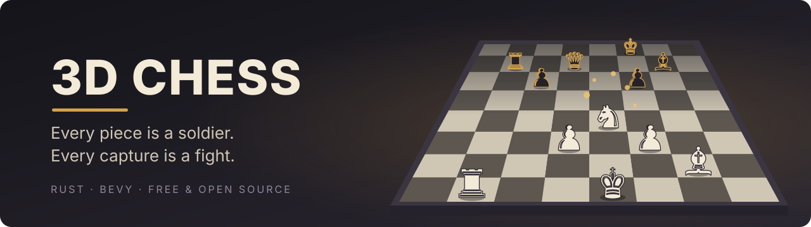
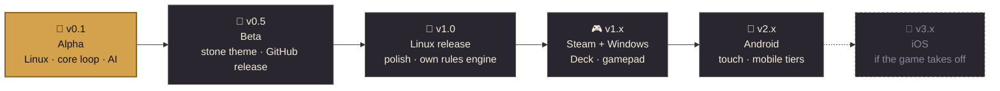
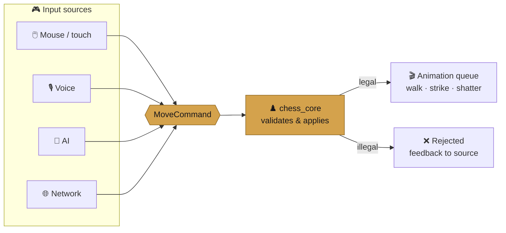

<div align="center">



<br>


[](https://github.com/AbdulkadirEroglu/3d-chess/actions/workflows/ci.yml)
[](#-license)


**[Features](#-features)** · **[Roadmap](#-roadmap)** · **[Quick start](#-quick-start)** · **[How it works](#-how-it-works)** · **[Contributing](#-contributing)**

</div>

---

## ♞ What is this?

> Real chess rules, but the pieces are **animated 3D troops**. They march to their squares, clash when they capture, and shatter when they fall. Command them with the mouse or, later, **with your voice**.

---

## ✨ Features

<table>
<tr>
<td width="33%" valign="top">

### 🏰 Living pieces
Stone soldiers that walk, gallop and slide. Every move is animated.

`alpha` · `beta`

</td>
<td width="33%" valign="top">

### ⚔️ Real fights
Captures are battles: the attacker strikes, the defender breaks apart.

`beta`

</td>
<td width="33%" valign="top">

### 🤖 AI opponent
No one to play with? The built-in AI takes the other side.

`alpha`

</td>
</tr>
<tr>
<td valign="top">

### 🎙️ Voice commands
*"Knight to F3."* Push to talk and your troops obey. Works offline.

`after v1.0`

</td>
<td valign="top">

### 🎨 Themes
Swap the army, board and scenery. Stone comes first; more follow.

`after v1.0`

</td>
<td valign="top">

### 🌐 Multiplayer
Hot-seat on one machine now, online matches later.

`alpha` · `after v1.0`

</td>
</tr>
</table>

---

## 🗺️ Roadmap



| | Milestone | Highlights |
|:-:|---|---|
| 🟡 | **v0.1 Alpha** | Full rules · mouse controls · placeholder pieces · local 2-player · AI opponent |
| ⚪ | **v0.5 Beta** | Stone army · animated captures · menus & sound · public Linux builds |
| ⚪ | **v1.0 Linux** | Polish · cinematic captures · our own rules engine · AppImage/Flatpak |
| ⚪ | **v1.x Steam** | Windows · Steam Deck · achievements · gamepad |
| ⚪ | **v2.x Android** | Touch controls · mobile performance |
| ⚪ | **v3.x iOS** | Only if the game finds its players |

<sub>🟡 in progress · ⚪ planned · Full details and feature tracks in <a href="ROADMAP.md">ROADMAP.md</a></sub>

---

## 🚀 Quick start

```sh
git clone https://github.com/AbdulkadirEroglu/3d-chess.git && cd 3d-chess
cargo run -p game
```

<details>
<summary><b>📦 System libraries (Linux)</b></summary>

<br>

| Distro | Command |
|---|---|
| Arch | `sudo pacman -S alsa-lib systemd-libs wayland libxkbcommon` |
| Debian / Ubuntu | `sudo apt install libasound2-dev libudev-dev libwayland-dev libxkbcommon-dev` |
| Fedora | `sudo dnf install alsa-lib-devel systemd-devel wayland-devel libxkbcommon-devel` |

The Rust toolchain is pinned in `rust-toolchain.toml`; `rustup` installs the right version automatically.

</details>

<details>
<summary><b>⚡ Developer commands</b></summary>

<br>

| Task | Command |
|---|---|
| **Run all CI checks locally** | `./scripts/ci.sh` |
| Run (fast rebuilds) | `cargo run -p game --features bevy/dynamic_linking` |
| Watch the AI play itself (animation check, soak test) | `CHESS_DEMO=1 cargo run -p game` |
| Play with a theme pack | `CHESS_THEME=test cargo run -p game` (generate it first: `python3 scripts/make_test_theme.py`) |
| Check models against the spec | `python3 scripts/check_asset.py crates/game/assets/themes/<name>` |
| Verbose logs | `RUST_LOG=game=debug,chess_ai=trace cargo run -p game` |
| Test | `cargo test --workspace` |
| Lint | `cargo clippy --workspace --all-targets -- -D warnings` |
| Format | `cargo fmt --all` |
| Licenses & advisories | `cargo deny check` |
| Unused dependencies | `cargo machete` |
| Enable pre-commit checks | `git config core.hooksPath .githooks` |

</details>

---

## 🧠 How it works

Every input (mouse, voice, AI or network) becomes the same **`MoveCommand`**. The rules decide; the 3D world just shows what happened.



<details>
<summary><b>📁 Project layout</b></summary>

<br>

```
3d-chess/
├── crates/
│   ├── chess_core/   ♟️  rules & game state (plain Rust, no engine)
│   ├── chess_ai/     🤖 computer opponent
│   └── game/         🎮 Bevy app: board, pieces, input, animation, UI
├── assets/themes/    🎨 swappable theme packs
├── docs/             📚 design notes & decisions
├── .claude/          🧩 agent settings, hooks & skills
└── .githooks/        ✅ pre-commit checks
```

</details>

<details>
<summary><b>🧰 Tech stack</b></summary>

<br>

| Layer | Choice |
|---|---|
| Language |  |
| Engine |  |
| Chess rules | `cozy-chess` → our own engine before v1.0 |
| Physics / Audio | `avian3d` · `bevy_kira_audio` |
| Voice (planned) | Whisper (desktop) · Vosk (mobile) |
| Assets | Blender → glTF · quality tiers per platform |

Full rationale, versions and licenses: [TECH_STACK.md](TECH_STACK.md)

</details>

---

## 🤝 Contributing

| 📖 Read first | |
|---|---|
| [`AGENTS.md`](AGENTS.md) | Rules for humans and AI agents: simplicity, comments, logging, scope |
| [`ARCHITECTURE.md`](ARCHITECTURE.md) | Code map & glossary: **check here before writing anything new** |
| [`TECH_STACK.md`](TECH_STACK.md) | Approved crates, versions, license policy |
| [`ROADMAP.md`](ROADMAP.md) | What's being built now, and what comes later |

Working with Claude Code? Use **`/feature <task>`** to build and **`/audit`** to review before committing.

---

## 📜 License

Free and open source. The code is dual-licensed under either of

| | |
|---|---|
| [MIT License](LICENSE-MIT) | short and simple |
| [Apache License 2.0](LICENSE-APACHE) | adds an explicit patent grant |

at your option. This is the same as Bevy and most of the Rust ecosystem.

Unless you explicitly state otherwise, any contribution you intentionally submit for inclusion in this project shall be dual-licensed as above, without any additional terms or conditions.

<sub>Game assets (models, textures, audio) may carry their own licenses, listed in <code>assets/CREDITS.md</code> once assets arrive.</sub>

---

<div align="center">

<sub>Built with 🦀 Rust and 🕊️ Bevy</sub>

</div>
